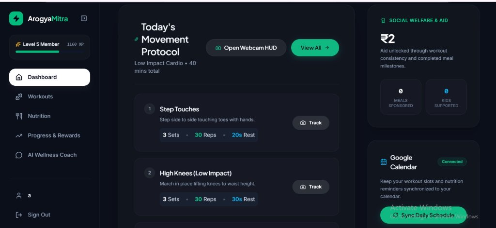
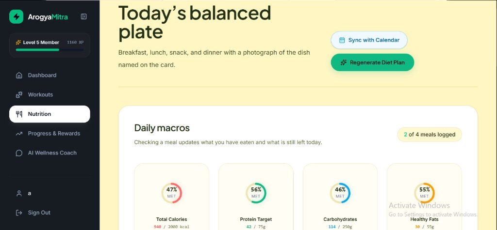
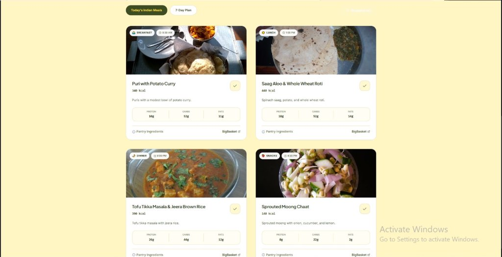
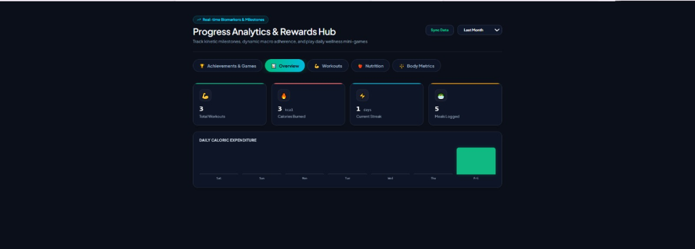
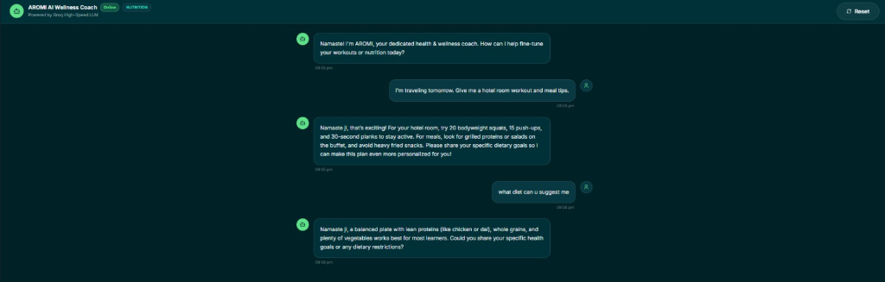

# 🩺 ArogyaMitra – AI-Powered Fitness & Wellness Platform

[](https://arogya-mitra-jade.vercel.app/)
[](https://arogyamitra-api-12n2.onrender.com/)
[](https://react.dev/)
[](https://groq.com/)

ArogyaMitra is a full-stack AI-powered fitness and wellness platform that delivers personalized workout plans, Indian nutrition guidance, intelligent progress tracking, real-time pose tracking, and an AI chatbot coach — all in one integrated system.

Built with React + FastAPI + Groq (Llama 3.3 70B), the platform provides a complete digital wellness experience with gamification and charity-driven motivation.

🔗 **Live Website**: [https://arogya-mitra-jade.vercel.app/](https://arogya-mitra-jade.vercel.app/)  
🔗 **Live API Backend**: [https://arogyamitra-api-12n2.onrender.com/](https://arogyamitra-api-12n2.onrender.com/)

---

## 📸 App Screenshots & Preview

| 📊 Central Health Dashboard & Google Calendar | 🥗 Dynamic Macro Architecture & Controls |
| :---: | :---: |
|  |  |

| 🍲 Personalized Indian Meal Architecture & BigBasket | 📈 Progress Analytics & Rewards Hub |
| :---: | :---: |
|  |  |

| 🤖 AROMI AI Wellness Coach (Powered by Groq High-Speed LLM) |
| :---: |
|  |

---

## 🚀 Live Features

* 🏋️ **AI-Generated 7-Day Workout Plans** & YouTube Form Tutorial Guides
* 🥗 **AI-Customized Indian Nutrition Plans** with Dynamic Macro Tracking (Calories, Protein, Carbs, Fat)
* 📷 **AI Motion Tracking / Pose Detection** for Real-Time Exercise Reps
* 📊 **Real-Time Progress Tracking & Analytics** with Streaks & Milestones
* 🤖 **AI Chatbot Coach (ARO-mi)** for Personalized Recommendations
* 🎯 **Charity Points Reward System** (Complete Workouts $\rightarrow$ Feed Meals to Those in Need)
* 📅 **Automatic Google Calendar Sync** for Daily Workouts & Meal Reminders
* 🛒 **Smart Weekly Shopping List Generator** with BigBasket 1-Click Cart
* 🔐 **Secure JWT Authentication**

---

## 🧠 How It Works

```
Registration/Login
        ↓
Health Assessment (14 Questions)
        ↓
AI Generates:
   → 7-Day Workout Plan
   → 7-Day Nutrition Plan
        ↓
Dashboard Overview
        ↓
User Logs Workouts & Meals
        ↓
Stats + Charity Points Update
        ↓
Chat with ARO-mi for Guidance
```

---

## 🛠 Tech Stack

* **Frontend**: React 18, Vite, Tailwind CSS, Framer Motion, Lucide Icons
* **Backend**: FastAPI, SQLAlchemy, SQLite / PostgreSQL, Uvicorn
* **AI & LLM**: Groq Cloud (Llama 3.3 70B)
* **Integrations**: Google Calendar API, YouTube Data API, BigBasket Cart
* **Hosting**: Vercel (Frontend), Render (Backend)
* **Auth**: Secure JWT Authentication (OAuth2)

---

## 📂 Project Structure

```text
ArogyaMitra/
│
├── assets/             # Screenshots, previews, and diagrams
│   └── screenshots/
│       ├── 01-dashboard.jpg
│       ├── 02-macro-rings.jpg
│       ├── 03-meal-plans.jpg
│       ├── 04-progress-analytics.png
│       └── 05-ai-coach.png
│
├── backend/            # FastAPI Python backend (routes, models, services)
├── frontend/           # React + Vite frontend (pages, components, stores)
└── README.md           # Project documentation
```

---

## ⚙️ Setup Guide

### 1️⃣ Clone Repository
```bash
git clone https://github.com/Neha-2005-VCE/ArogyaMitra.git
cd ArogyaMitra
```

### 2️⃣ Backend Setup
```bash
cd backend
pip install -r requirements.txt
```

Create a `.env` file inside `backend/`:
```env
GROQ_API_KEY=your_groq_api_key
GOOGLE_CALENDAR_CLIENT_ID=your_google_client_id
GOOGLE_CALENDAR_CLIENT_SECRET=your_google_client_secret
GOOGLE_CALENDAR_REDIRECT_URI=http://localhost:8000/api/calendar/callback
JWT_SECRET=your_secret_key
DATABASE_URL=sqlite:///./arogyamitra.db
```

Run backend server:
```bash
uvicorn main:app --port 8000 --reload
```
API runs at: `http://127.0.0.1:8000` | Interactive docs: `http://127.0.0.1:8000/docs`

### 3️⃣ Frontend Setup
```bash
cd ../frontend
npm install
npm run dev
```
Frontend runs at: `http://localhost:5173`

---

## 🧩 Troubleshooting
* Ensure health assessment is completed on first login.
* Verify `GROQ_API_KEY` is set in your backend `.env`.
* If syncing with Google Calendar, verify your Google Cloud Console redirect URI is authorized.
